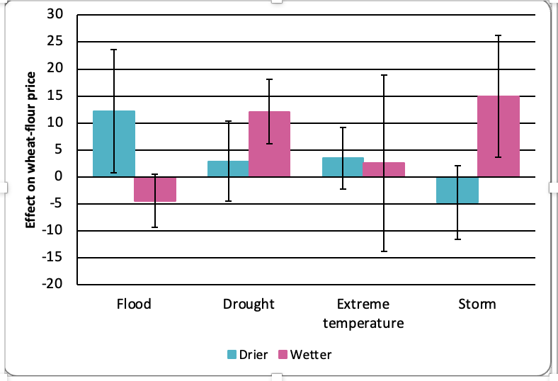
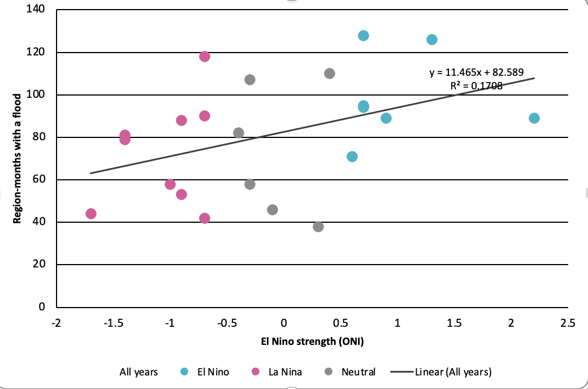

# Making the charts in Excel

There are three charts to try. Each one shows three variables. Finished versions are in the [answers](answers/) folder if you want to check your work.

## Chart 1. One disaster, two different results

Open `data/pooled_effects_for_excel.csv`.

| disaster | Drier | Wetter | Drier error bar | Wetter error bar |
|---|---|---|---|---|
| Flood | 12.21 | -4.43 | 11.43 | 4.89 |
| Drought | 2.92 | 12.11 | 7.42 | 5.96 |
| Extreme temperature | 3.46 | 2.55 | 5.67 | 16.36 |
| Storm | -4.7 | 14.98 | 6.84 | 11.31 |

Each number is the average change in wheat-flour prices after a disaster, in drier or wetter regions.

**Three variables:** disaster type (rows), regional climate (columns), and price effect (the numbers).

1. Select cells **A1 to C5**.
2. Go to **Insert → Clustered Column**.
3. Click any Drier bar, then **Chart Design → Add Chart Element → Error Bars → More Error Bar Options**. Choose **Custom → Specify Value** and use cells **D2:D5** for both positive and negative.
4. Do the same for the Wetter bars with cells **E2:E5**.
5. Add a vertical axis title, such as "Effect on wheat-flour price".

**Answer:** [chart1_answer.xlsx](answers/chart1_answer.xlsx), or see the picture below.

**What to look for.** Floods push prices up in drier regions but slightly down in wetter ones. If an error bar crosses zero, we cannot be confident there is any effect.

## Chart 2. Floods over time, coloured by El Niño

Open `data/floods_by_year_for_excel.csv`.

| year | El Nino | La Nina | Neutral |
|---|---|---|---|
| 2000 | | 44 | |
| 2001 | | 42 | |
| 2002 | | | 46 |
| 2003 | 89 | | |
| ... | | | |

Each number counts how many region-months had at least one flood that year, across the same 410 regions in 62 countries. Each year's number sits in the column for that year's climate phase (El Niño, La Niña, or Neutral). That is a simple trick to make Excel colour the bars by group.

**Three variables:** year (x-axis), number of floods (bar height), and climate phase (bar colour).

1. **Delete the word "year" in cell A1** and leave the cell empty. This tells Excel that column A is labels, not data.
2. Select cells **A1 to D23**.
3. Go to **Insert → Stacked Column**. (Stacked, so the empty cells do not leave gaps.)
4. Right-click a bar, choose **Format Data Series**, and set **Gap Width** to about 30%.
5. Add axis titles.

**Answer:** [chart2_answer.xlsx](answers/chart2_answer.xlsx)

**Think about it.** Do El Niño years have more floods? Is this chart enough to say El Niño *causes* floods? What else would you want to know?

`data/floods_by_year.csv` has the same numbers in a "long" layout, plus storms. Try a line chart of floods and storms over time. That is three variables too: year, count, and disaster type.

## Chart 3. A scatter plot with a fitted line

Open `data/floods_vs_el_nino_for_excel.csv`.

| El Nino strength (ONI) | All years | El Nino | La Nina | Neutral |
|---|---|---|---|---|
| -1.7 | 44 | | 44 | |
| -0.7 | 42 | | 42 | |
| -0.1 | 46 | | | 46 |
| 0.9 | 89 | 89 | | |
| ... | | | | |

Each row is one year. The first column is how strong El Niño was that year (above 0.5 is El Niño, below -0.5 is La Niña). "All years" is the number of region-months with a flood. The last three columns repeat that number in the column for the year's phase, so Excel can colour the points.

**Three variables:** El Niño strength (x-axis), floods (y-axis), and phase (colour).

1. Select cells **A1 to E23**.
2. Go to **Insert → Scatter**. You get four sets of points. The coloured ones are the phases, and "All years" sits on top of them.
3. Click one of the "All years" points, then **Chart Design → Add Chart Element → Trendline → Linear**. Right-click the line, choose **Format Trendline**, and tick **Display R-squared value on chart**.
4. Click the "All years" points again, choose **Format Data Series → Marker → No marker**, and delete "All years" from the legend. Now you see the coloured points and one line through all of them.
5. Add axis titles.

**Answer:** [chart3_answer.xlsx](answers/chart3_answer.xlsx), or see the picture below.

**What to look for.** The line slopes up, so stronger El Niño years tend to have more floods in these regions. But the points are spread widely around the line, and there are only 22 years. This is a weak relationship. How would you describe it in one honest sentence?
